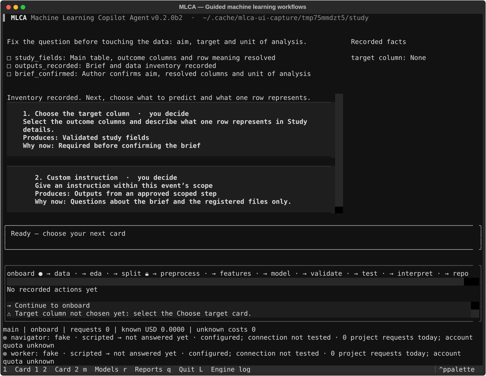

# MLCA: Machine Learning Copilot Agent (v2)

MLCA guides a machine-learning study step by step. Instead of an open-ended chat, a study moves through a fixed sequence of **events**. At each step you choose from a few natural **options**, or give a custom instruction limited to the current event. Every step becomes a standalone, numbered script with recorded outputs. Rules that protect the science are enforced by code, not by prompts: the test set stays locked, models are fitted on training rows only, and every number has a source.

```
onboard → data → eda → split 🔒 → preprocess → features → model ⇄ validate → test (unlock once) → interpret → report
                                     └──────── iteration loop (validation only) ────────┘
```

## How a step works

1. **Status:** the engine rebuilds the project state from its event log.
2. **Options:** two to three options from the current event's action catalog, plus `custom`. When an event is done, the next event is offered.
3. **Choice:** you choose (or an agent chooses; see *Two ways to use MLCA*).
4. **Script:** a short, standalone Python script is written for the action and run in a sandbox:
   - only declared inputs are readable;
   - no network;
   - the test set is invisible until unlocked.
5. **Record:** outputs, metrics and facts (each citing the file it came from) go into the event log. The event's sub-goals are then checked by code.

Each event has a goal, sub-goals, an action catalog and a custom-instruction scope. These are defined in a **workflow template**:
- `templates/tabular_classification/`: logistic baseline vs gradient boosting, ROC AUC;
- `templates/survival/`: Cox vs penalised Cox, C-index.

The template content is short by design; see [templates](docs/templates.md).

## Two ways to use MLCA

| | **Standalone** (available now) | **Docked to another agent through MCP** (available now) |
|---|---|---|
| Interface | terminal UI (`mlca`), CLI, browser view of the TUI (`mlca web`) | Claude Code, Codex, Hermes, OpenClaw, Cursor or any MCP client, connected with `mlca mcp` |
| Who proposes options and writes scripts | MLCA's own **Navigator** and **Worker** models (your API keys: OpenAI, OpenRouter or a local OpenAI-compatible server) | **Brain mode** (default): the connected agent proposes options and writes each script; MLCA makes no model calls. **Driver mode**: the agent only chooses; MLCA's Navigator and Worker do the work |
| Rules | all engine rules | the same engine rules; the agent cannot confirm sub-goals, unlock the test set or approve packages; it can only request them, and you approve in MLCA |
| Attribution | decisions recorded as `user` | decisions recorded as `agent:<client>/<version>`, so reports separate human and agent work |

In brain mode, a script written by Claude or Codex goes through exactly the same checks as one written by MLCA's Worker:
- option validation;
- static checks;
- the sandbox;
- the training-only fit rule;
- the test lock.

## Connect an agent

```sh
mlca mcp install --client claude --with-skill       # preview
mlca mcp install --client claude --with-skill --yes # register only with explicit consent
mlca mcp install --client codex                    # preview
mlca mcp doctor                                   # real stdio tool discovery
```

The server is included in the Python package. See [MCP docking](docs/mcp.md) for Hermes,
OpenClaw, Cursor, work orders, polling, privacy and approval commands. Human-only enforcement
is a Session/MCP boundary; MCP client identity is attribution, not OS authentication.

## Install

The distribution name is `mlcagent`; the command and Python imports remain `mlca`.

Python ≥ 3.11 and [uv](https://docs.astral.sh/uv/) are required. Install the beta with an explicit version:

```sh
uv tool install mlcagent==0.2.0b2
```

Plain `uv tool install mlcagent` does not select this prerelease. Shell download, npm and Homebrew channels remain unpublished.

From this checkout: `uv sync --group dev`, then `uv run mlca`. See [installation](docs/install.md).

**Isolation:**
- **Linux:** full isolation (level A) with bubblewrap: `sudo apt install bubblewrap`.
- **macOS and native Windows:** only the weaker level B, which must be enabled explicitly (`sandbox.allow_level_b: true`).
- **Windows:** WSL2 is recommended.

## Guided terminal UI

Start `mlca`, create or open a study, and follow the numbered cards. Study details, confirmation,
navigation and scoped custom instructions are visible choices; no hidden hotkey is needed to reach
`data`. Arrow keys plus Enter and clicking work too. The journey shows your branch's progress;
**L** toggles the raw engine log, and **m** opens Models even while a step is running.



Screenshots use synthetic fixtures and fake providers, not a live scientific run.
[First-run guide](docs/native-onboarding.md) · [Models screen](docs/screens/models.svg)

## Configure models (standalone mode)

**Start free with OpenRouter** authorizes your own account through browser PKCE or a headless code.
A secure OS keyring can remember the returned key; session-only fallback is available in the TUI.
Navigator and Worker use `openrouter/free`, whose selected model is logged per request. Free requests
have quotas, and a full study may exceed them. Use **Test connection** only when ready to consume
one request per role. **Refresh OpenRouter quota** asks for account metadata, not inference.

Models can be switched between steps; saves during execution queue until the step ends. Changes are
logged and reported. `mlca bench run ... --lock-models` protects configured models for a measured
run; it cannot freeze a router's upstream selection. **Continue with ChatGPT** is registration-gated
until MLCA's own OpenAI client ID is supplied. OpenAI API keys, local Ollama and custom servers remain
available. Optional pasted-key persistence uses the secure OS keyring only, never a plaintext file.

Copy [examples/config.yaml](examples/config.yaml) to `~/.config/mlca/config.yaml` (or run `mlca config edit`). Choose a provider and model for each role. Environment keys (`OPENAI_API_KEY`, `OPENROUTER_API_KEY`), session-only pasted keys and secure keyring references are supported. The explicit free-router preset supplies its known zero token prices; other model prices or request bounds must be configured. See [providers](docs/providers.md).

## Quick start

```bash
mlca init ./study --data data.csv --template tabular_classification   # asks the brief; resolves the target column
mlca -p ./study                                                        # terminal UI
# or step by step from the CLI:
mlca -p ./study options
mlca -p ./study choose 1
mlca -p ./study confirm brief_confirmed "Aim, target and unit checked"
mlca -p ./study next
```

**Human decisions are explicit:**
- `confirm <sub-goal> "<note>"` for author checks;
- `unlock-test --phrase "UNLOCK TEST" --reason "..."` once, in the test event;
- `package` approvals.

After the test set is unlocked, fitting, validation loops and package changes are closed for the project.

Supporting inspections follow the main actions in fallback menus. Once an event is complete,
the menu offers `next` first, then unrun supporting actions and scoped custom instructions.
Those steps preserve completed checks. To try a primary alternative, branch before its step.

## Trust boundary

MLCA enforces decisions and data access only through its own API and sandboxed steps.
A connected agent's native file or shell tools can bypass MCP: they may read the original data,
`.mlca/data/splits/`, the test key under the MLCA user-data directory, or invoke human approval
commands. Generated `tables/`, `figures/`, `reports/` and `scripts/` are also local copies of evidence.
Reports therefore describe `agent_file_access` as **unknown (outside MLCA)**.

`mlca -p ./study mcp install --client claude --scope project` previews recommended permissions;
`--yes` backs up and merges them into `./study/.claude/settings.json`. The block denies native
shell execution and reads/edits of registered data, private state, keys and evidence copies.
Other clients receive equivalent guidance. These are client restrictions, not OS authentication:
disable other filesystem tools and bypass modes, or use a separate OS identity/container.
See [MCP trust boundary](docs/mcp.md#trust-boundary) before connecting a client.

With `allow_sample_rows: false`, private salted fingerprints check values across all columns,
regardless of their names, at six and four significant digits. The additional table heuristic flags
at least `min(3, n_columns)` distinct cell matches to one source row; exact shared-column checks
also remain. Full-row facts are checked without requiring matching column names. Matching outputs
are flagged in reports; genuine summaries normally remain readable, but coincidental matches may
be refused. Existing indexes upgrade from unchanged registered data without decrypting the test set.

This guard catches accidental and simple copies, not a deliberate agent. In brain mode the agent
writes the code and can encode data in strings, noise, figures or other derived outputs. Those
results are sent to the agent's provider by design. For confidential data, use standalone driver
mode with every model local and no external agent receiving outputs; the heuristic cannot guarantee
confidentiality for brain mode.

## Scientific guard rails

| Rule | Where it is enforced |
|---|---|
| Options are only actions from the current event's catalog, with validated parameters | `engine/options.py` |
| An event can be entered only when its gate passes; sub-goals are ticked only by code checks or your confirmation | `engine/gates.py`, `engine/checks.py` |
| Custom instructions must stay in the event's scope | `engine/scope_guard.py` |
| The split is done by the engine; the test partition is encrypted until unlocked | `engine/split.py`, `sandbox/vault.py` |
| Scripts run sandboxed: declared inputs only, no network, writes only to their own step folder | `runner/`, `sandbox/` |
| In preprocess, features and model, every fit goes through `mlca_runtime.fit_record` on the exact frozen training rows; other events may not fit at all | `runner/static_checks.py`, `mlca_runtime` |
| Every fact cites the file it came from | `engine/facts.py` |

**Limits:** level B (macOS, Windows) is an audit hook, not an operating-system boundary. Code checks cannot prove the meaning of every computation. Domain review of targets, units, preprocessing and interpretation remains yours. See [security model](docs/security-model.md).

## Evaluation

`mlca metrics` writes sourced completion, recovery, intervention, time, usage and provenance measurements without model calls. After a brain-mode run, `mlca usage import` imports only client-reported usage fields; unknown costs stay unavailable. `mlca bench run` creates independent driver runs from a task card and keeps failures; scripted policy decisions are labelled separately from humans. See [metrics](docs/metrics.md).

## Evidence and reproducibility

Everything lives in the project's `.mlca/` folder:
- the append-only, hash-chained event log;
- the frozen template;
- the analysis environment and its lock file;
- the immutable step folders;
- the encrypted test partition;
- the usage and egress logs.

The `scripts/`, `figures/`, `tables/`, `reports/` and `PROJECT_LOG.md` folders are regenerated views; edits to them are detected.

```bash
mlca log --verify        # integrity of the event log
mlca replay --verify     # re-run every step script in a fresh environment and compare outputs
mlca report all          # methods draft, provenance, figure index, usage (no model calls)
mlca branch alt --from <record or step>   # try another path; mlca checkout main to return
```

## Test datasets (for hands-on testing; not part of this repository)

Public benchmark datasets for trying MLCA, outside the repository so the code tree stays small. **No test run on them has begun** (as of 2026-10-12); the table is only a record of what is available and where.

Folder: `/home/prime/Documents/github/mlca-paper-codebases/benchmark_datasets/` (provenance in its `README.md`; produced by its `pull_datasets.py`).

| File | Task / template | Rows | Columns | Target |
|---|---|---|---|---|
| `breast_cancer_diagnostic_uci.csv` | binary classification (`tabular_classification`) | 569 | 31 | `Diagnosis` (M / B) |
| `heart_disease_cleveland_uci.csv` | clinical binary classification | 303 | 15 | `heart_disease_binary` (an original `num` column is also present) |
| `adult_census_uci.csv` | mixed continuous and categorical, binary | 48,842 | 15 | `income` |
| `dry_bean_uci.csv` | multiclass (7 classes) | 13,611 | 17 | `Class` |
| `lung_cancer_survival.csv` (NCCTG) | survival (`survival`) | 228 | 11 | duration `time`, event **`status`** (1 = death, 0 = censored). The added `event` column is all zeros: do not use it |
| `gbsg2_breast_cancer_survival.csv` (GBSG2) | survival (`survival`) | 686 | 10 | duration `time`, event `cens` |

Row and column counts were checked on the files (columns include the target). When creating a study, name the target column exactly as above. For the survival files, give the duration and event columns separately. **Known defect in `lung_cancer_survival.csv`:** `pull_datasets.py` (line 108) derives `event` as `status == 2`, but this file's `status` is already 0/1 (165 deaths, 63 censored), so `event` is 0 for every row and a study using it would have no events. Use `status` as the event column, or regenerate the file after fixing the script. The dataset folder was not modified.

## Status

- **Hands-on testing:** native onboarding is being tested by the author. Complete real-data driver/brain studies remain pending; the datasets above are staged for them.
- **Beta 2:** [`mlcagent` 0.2.0b2](https://pypi.org/project/mlcagent/0.2.0b2/) is published with the guided native TUI and provider controls; beta 1 is yanked. The command remains `mlca`. Publication evidence is recorded in [validation](docs/IMPLEMENTATION_STATUS.md).

- **Core (plan.md):** P0–P8, P10 and P11 built; beta version `0.2.0b2`. **193 offline tests pass, 1 skipped** (PowerShell unavailable). Release checks are recorded in [validation](docs/IMPLEMENTATION_STATUS.md).
- **Not yet done:**
  - runs with real providers;
  - the study on real data;
  - native macOS and Windows checks.
- **MCP docking ([plan_mcp.md](plan_mcp.md)):** M0–M6 implemented: 14 stdio tools, brain/driver modes, human approvals, filtered evidence and usage records. Manual runs in real clients (M7) remain pending.
- **Licence:** [CC BY-NC-ND 4.0](LICENSE) (`CC-BY-NC-ND-4.0`), chosen by the author. The approved distribution name is `mlcagent`; the executable and imports remain `mlca`.

## Documentation

| Document | Contents |
|---|---|
| [plan.md](plan.md) | Core design, phases and current status |
| [docs/mcp.md](docs/mcp.md) | Client setup, tool loop, approvals and manual validation |
| [plan_web_mcp.md](plan_web_mcp.md) | `mlcagent-web-mcp`: brain mode for the browser edition (follow-up, stage 1 mapping) |
| [plan_web.md](plan_web.md) | Browser edition: driver mode running in WebAssembly (planned) |
| [plan_mcp.md](plan_mcp.md) | MCP server: docking modes, tools, safety, phases |
| [docs/architecture.md](docs/architecture.md) | Components and data flow |
| [docs/templates.md](docs/templates.md) | Writing workflow templates (short-content rules) |
| [docs/event-log.md](docs/event-log.md) | Record types and replay |
| [docs/security-model.md](docs/security-model.md) | Isolation levels and their limits |
| [docs/providers.md](docs/providers.md) | Model providers and roles |
| [docs/install.md](docs/install.md), [docs/releasing.md](docs/releasing.md) | Install channels; author-only release setup |
| [docs/m7-vm-brain-mode.md](docs/m7-vm-brain-mode.md) | Manual end-to-end test on a fresh VM with Claude Code in brain mode |
| [docs/testing.md](docs/testing.md) | Running the offline tests (prime the uv cache once: `uv run python scripts/prime_test_cache.py`) |
| [docs/DECISIONS.md](docs/DECISIONS.md), [CHANGELOG.md](CHANGELOG.md) | Decisions and history |
