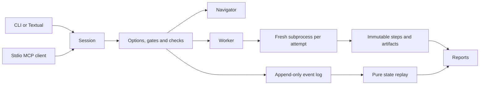
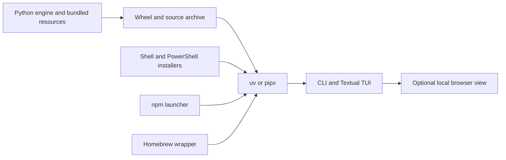

# Architecture

All front ends use `mlca.api.Session`. The Session owns a branch, configuration, request client and
workflow snapshot. It delegates turn execution to the engine; only the engine can enter events,
record check outcomes or unlock test access.

The Navigator proposes catalog actions and extracts cited facts. The Worker returns one standalone
Python script; errors lead to bounded repair attempts. Each execution uses a separate, pinned project
environment and named input paths. The tool environment holds the provider clients; the analysis
runtime contains only artifact and fit-recording helpers.

Privileged actions (inventory/brief, split freezing and report projection) are engine operations.
Their step scripts identify the operation rather than reproducing privileged behavior with arbitrary
Python. `replay --verify` reproduces splits with engine code and reruns ordinary scripts separately.
Encryption ciphertext is randomized; it is not expected to hash identically across a new sealing.

Project templates, style and runtime source are snapshotted at initialization. Template snapshots are
hash-checked on open. Changes to author templates affect new projects, not historical studies.

Validation loops invalidate downstream checks and confirmations. Event generations prevent an old
artifact from satisfying a new iteration. All fitting/partition changes close after any test unlock
in the project, including other branches. Branches preserve history; they cannot undo exposure.

The stdio MCP server and npm launcher are implemented. General frontend RPC, Ink, desktop,
account login, special free-provider access and image generation remain deferred.

## Distribution

The wheel/source archive contains the Python engine, runtime helper and resources. PyPI installs it
directly; shell, PowerShell, npm and Homebrew wrappers delegate to the same artifact/version with uv.
The optional loopback browser view serves the existing Textual app. No second engine or model router
is introduced by packaging. Version and distribution-name sources are shared; releases require
licence/name approval and a protected environment. See [releasing](releasing.md).

## MCP execution sources

The official SDK server (`mcp/server.py`) is a thin Session client. Brain mode uses external
options and persisted ScriptRequested work orders; driver mode retains Navigator/Worker.
ExternalSource and WorkerSource share run_attempt, static checks, test exposure and artifact
collection. Background threads retain the project action lock and publish pollable status.
Only a human Session can resolve approval requests. Tool/resource results pass through compact
serialization and one usage/egress envelope. See [MCP docking](mcp.md).

Private row fingerprints (`privacy/rows.py`) are an engine-side derived store indexed from
hash-verified registered inputs and splits. Salted cells at six/four significant digits and row
identities support name-independent matching and exact shared-column projections without plaintext.
Collection annotates tables; MCP rechecks reads and blocks full-row facts before returning
study state. The store is never
mounted into analysis steps. Client permission recommendations (`mcp/permissions.py`) are separate
from engine authorization; all generated reports describe external file access as unknown.
