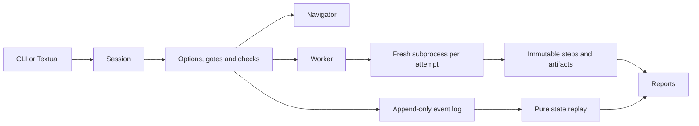

# Architecture

All front ends use `mlca.api.Session`. The Session owns a branch, configuration, request client and
workflow snapshot. It delegates turn execution to the engine; only the engine can enter events,
record check outcomes or unlock test access.

The Navigator proposes catalog actions and extracts cited facts. The Worker returns one standalone
Python script; errors lead to bounded repair attempts. Each execution uses a separate, pinned project
environment and named input paths. The tool environment holds the provider clients; the analysis
runtime contains only artifact and fit-recording helpers.

Privileged actions (inventory/brief, split freezing and report projection) are engine operations.
Their step scripts identify the operation rather than reproducing privileged behavior with arbitrary
Python. `replay --verify` reproduces splits with engine code and reruns ordinary scripts separately.
Encryption ciphertext is randomized; it is not expected to hash identically across a new sealing.

Project templates, style and runtime source are snapshotted at initialization. Template snapshots are
hash-checked on open. Changes to author templates affect new projects, not historical studies.

Validation loops invalidate downstream checks and confirmations. Event generations prevent an old
artifact from satisfying a new iteration. All fitting/partition changes close after any test unlock
in the project, including other branches. Branches preserve history; they cannot undo exposure.

P9 (RPC, Ink, desktop, npm launcher, account login, special free-provider access and image generation)
is deliberately absent from this implementation.
